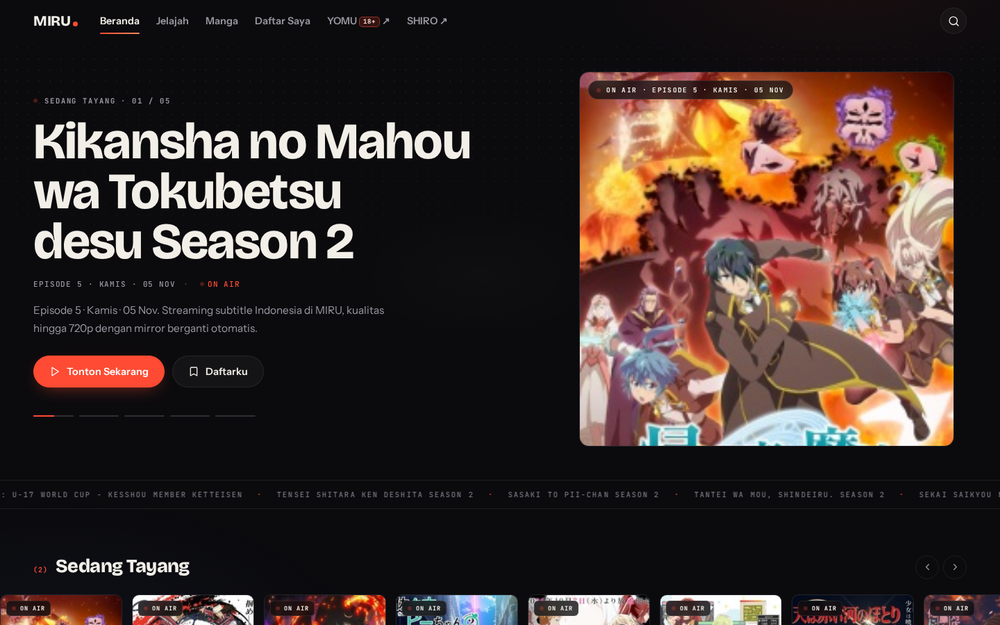

# AnimeHub

Agregator streaming anime dan baca manga dengan antarmuka lokal: **MIRU** (anime), **SHIRO** (manga biasa), dan **YOMU** (manga 18+). Backend Flask melakukan scraping/API secara real-time; frontend statis tanpa build step.




## Fitur

- **MIRU (`/baru`)**: anime on-going, jadwal rilis, genre, pencarian lokal/full-text, detail episode, streaming via relay, download link, favorit, progress tonton, PWA.
- **SHIRO (`/shiro`)**: katalog manga biasa dari MangaDex (tanpa auth), filter genre/sort/pencarian, detail + daftar chapter, reader vertikal/per-halaman, cover via relay lokal.
- **YOMU (`/manga`)**: reader manga 18+ dari nhentai API v2. Halaman memuat peringatan 18+; jangan dibuka jika belum dewasa.
- **Web lama (`/`)**: UI original AnimeHub + PWA.
- **SQLite**: cache anime, progress, favorit. Database dibuat lokal dan **tidak ikut di repo**.

## Menjalankan

Butuh Python 3.10+ dan koneksi internet.

```bash
git clone https://github.com/ikyletwar/animehub.git
cd animehub
./backend/run.sh
```

Script akan membuat `backend/.venv`, menginstal dependensi, lalu menjalankan server di:

```text
http://127.0.0.1:8000
```

Buka:

```text
http://127.0.0.1:8000/baru   # MIRU anime
http://127.0.0.1:8000/shiro  # SHIRO manga biasa
http://127.0.0.1:8000/manga  # YOMU 18+
http://127.0.0.1:8000/       # UI lama
```

Manual:

```bash
python3 -m venv backend/.venv
backend/.venv/bin/pip install -r requirements.txt
cd backend
./run.sh
```

## Konfigurasi

| Env | Default | Fungsi |
|---|---|---|
| `ANIMEHUB_DB` | `backend/animehub.db` | lokasi SQLite |
| `ANIMEHUB_FRONTEND_DIR` | `../frontend` | folder `webbaru/mangabaru/shirobaru.html` |

## Struktur

```text
backend/    Flask API + scraper (server.py, otakudesu.py, manga.py, yomu.py, shiro.py, store.py)
frontend/   UI MIRU / SHIRO / YOMU (HTML statis)
web/        UI lama + PWA
screenshots/
requirements.txt
LICENSE     MIT
```

## Endpoint utama

```text
GET  /api/ongoing              anime sedang tayang
GET  /api/list?page=1          katalog anime + cache lokal
GET  /api/search?q=naruto      cari anime
GET  /api/detail?url=...       detail + episode
GET  /api/schedule             jadwal rilis
GET  /api/genre?slug=action    anime per genre
GET  /api/favorites            daftar favorit
POST /api/progress             simpan posisi tonton
GET  /api/stream?ep=...&q=720p resolusi streaming + relay
GET  /api/shiro/list           katalog MangaDex (safe only)
GET  /api/shiro/gallery?url=   detail manga + chapters
GET  /api/shiro/pages?url=&ch= gambar chapter
GET  /api/manga/list           katalog nhentai (18+)
GET  /api/yomu/list            katalog YOMU (18+)
GET  /api/health               health check
```

## Catatan teknis

- **Otakudesu**: halaman episode hanya berisi iframe desustream; URL MP4 googlevideo bertanda tangan (`expire`, `ip`, `sig`) sehingga tidak di-cache dan diputar lewat relay lokal.
- **MangaDex**: dipakai dengan API publik tanpa auth. SHIRO hanya meminta `contentRating=safe`; gambar cover di-relay lewat `/api/shiro/cover/...` karena `uploads.mangadex.org` memberi bot challenge di browser.
- **nhentai**: API v2 (`/api/v2/...`), tanpa auth. DNS mungkin di-hijack ISP; `manga.py` memakai Cloudflare DoH untuk host nhentai dan tetap memverifikasi TLS via SNI.
- **Legal/lisensi**: kode di repo ini MIT. Nama, aset, konten, dan trademark milik pemilik masing-masing sumber. Pengguna bertanggung jawab mematuhi hukum dan ketentuan sumber lokal.

## Privasi

`animehub.db` berisi cache dan progress/favorit pribadi dan sengaja tidak disertakan. Repo ini tidak menyimpan history menonton/membaca.

## Lisensi

MIT — lihat [LICENSE](LICENSE).
